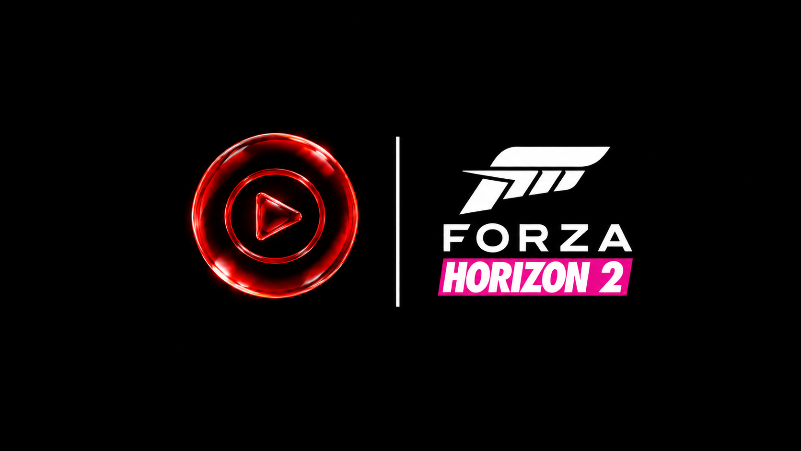

# FH2 Streaming Radio YTM

A mod for **Forza Horizon 2 (Azimuth builds)** that takes over an in-game radio station, which is **Horizon XS** by default, and plays your own YouTube music on it. Open YouTube Music or YouTube on any device on your network, tap the cast button, and pick "Forza Horizon 2". Whatever you play comes out of that station, with the song title and channel in the game's now-playing popup. When nothing is cast, the station shuffles your own songs from the `MUSIC` folder.

Not affiliated with YouTube, Google, Turn 10, Playground Games or Microsoft.

> [!CAUTION]
> **IMPORTANT:** Go into the game's **In-Game Audio Settings** and **TURN OFF the DJ Voice**.

> [!WARNING]
> **Only one radio mod at a time.** This mod and the Spotify version, [FH2 Streaming Radio](https://github.com/RussFactorShow/FH2-Streaming-Radio), can't run together, not even in the ExtraOptions Edition, because both change the same radio code in the game. Want it alongside other mods (anything besides our two radio mods)? Run the latest version of **Extra Options** and use our **ExtraOptions Edition**, which is the recommended way from here on out. The standalone version uses `D3DCompiler_47.dll`, so it can't share with other mods. Each mod has its own folder (`youtube-radio` here, `spotify-radio` there), and both support local music, so you can copy your `MUSIC` folder from one to the other.

## Install: ExtraOptions Edition (recommended)

You'll need the latest version of **Extra Options** with its mod loader installed.

1. **Remove the standalone version first** if you have it. Delete `D3DCompiler_47.dll` and the `youtube-radio` folder from next to `Azimuth.exe`, or two radio mods will run at once.
2. From [Releases](../../releases/latest), download **only** the `ExtraOptionsEdition` zip.
3. Drag the whole `YouTube Radio` folder from the zip into your build's `mods` folder (next to `loadorder.txt`). Extra Options loads it at the next game start and adds it to `loadorder.txt` by itself.
4. Start the game. The first time, the mod downloads two helper programs it needs (`yt-dlp` and `deno`, about 65 MB) into `youtube-radio\bin` in the background. There's nothing to download yourself.
5. On any device with YouTube Music or YouTube that's on the same Wi-Fi as the game PC, tap the cast button and pick **Forza Horizon 2**. Then play something.
6. Go into the in-game **Audio Settings** and **TURN OFF the DJ Voice**.
7. In-game, switch the radio to **Horizon XS**, or whichever station you picked in the config.

> [!NOTE]
> In the ExtraOptions Edition, every `youtube-radio\...` path on this page lives inside `mods\YouTube Radio\`. For example, your music goes in `mods\YouTube Radio\youtube-radio\MUSIC`, and the `TITLE SCREEN` folder is still inside `MUSIC`.

## Install: Standalone

1. From [Releases](../../releases/latest), download the standard `FH2-Streaming-Radio-YTM` zip (not the ExtraOptionsEdition one).
2. Copy `D3DCompiler_47.dll` and the `youtube-radio` folder into your Azimuth folder, so both are next to `Azimuth.exe`. If you had the Spotify version, replace its `D3DCompiler_47.dll`. Its `spotify-radio` folder can stay.
3. Start the game. The first time, the mod downloads two helper programs it needs (`yt-dlp` and `deno`, about 65 MB) into `youtube-radio\bin` in the background. There's nothing to download yourself.
4. On any device with YouTube Music or YouTube that's on the same Wi-Fi as the game PC, tap the cast button and pick **Forza Horizon 2**. Then play something.
5. Go into the in-game **Audio Settings** and **TURN OFF the DJ Voice**.
6. In-game, switch the radio to **Horizon XS**, or whichever station you picked in the config.

## Coming over from the Spotify version

Copy the contents of `spotify-radio\MUSIC` into `youtube-radio\MUSIC` and your local songs come along.

## Local music

Drop your songs into `youtube-radio\MUSIC`. They play on shuffle on the takeover station whenever nothing is cast. If your local songs are louder or quieter than YouTube, adjust `local_boost_db` in `config.ini`. Set `local_music = false` to turn local music off.

## How it behaves

- The phone's controls work: play, pause, next, previous, seek, and volume. The phone's queue plays in order, and the next song is fetched ahead of time so it starts right away.
- A song takes a few seconds to start the first time, since it has to be fetched. The last 60 songs you played are kept in `youtube-radio\cache\audio` and start instantly.
- The music pauses while the game isn't playing the station (menus, loading, other stations) and carries on when you come back. Set `pause_when_silent = false` for live-radio behavior.
- Disconnecting in the phone app stops the music and the station goes back to your own songs. Just closing the app keeps the music going.
- Without casting, the links in `youtube-radio\youtube.txt` (videos, playlists, YouTube Music links) play shuffled instead.
- Age-restricted or members-only videos: export your browser's YouTube cookies as `cookies.txt` (Netscape format) into `youtube-radio`.
- `yt-dlp` checks for updates once a day, since YouTube changes often.

## Picking a different station

Set `station =` in `youtube-radio\config.ini` to a station's number or name, for example `station = Innovative Leisure`. The stations are Horizon Pulse (1), Bass Arena (2), Horizon XS (3, the default), Radio Levante (4), Hospital Records (5), Ninja Tune (6), and Innovative Leisure (7).

## Other settings

Edit `youtube-radio\config.ini` while the game is closed. You can change the cast name (`device_name`), and `boost_db` (0 to 12, default 4) raises the station's overall volume. `local_boost_db` (default 6) does the same for your local music. Existing `config.ini` files keep their own values; replace `config.ini` to get the new defaults. `replace_logo = false` keeps the station's original logo. To use your own logo, put `logo.png` or `logo.jpg` in `youtube-radio`.

## Skip songs from your controller

Hold **LB + X** to skip to the next song (YouTube or local music). Change the buttons with `skip_combo` in `config.ini` (two or more of `A B X Y LB RB LT RT Back Start LS RS Up Down Left Right`, joined with `+`), or set `skip_combo = off` to disable it.

## Known issues

- In rare cases the phone's YouTube Music or YouTube app stays stuck on "connecting". Force-quit the phone app and connect again.

## Troubleshooting

- Check `youtube-radio\youtube-radio.log`, and `tools.log` for messages from `yt-dlp`.
- Set `test_tone = true` in `config.ini` to hear a beep on the station instead of music, which tests the game side by itself.
- If your phone doesn't show Forza Horizon 2 in the cast list, make sure it's on the same Wi-Fi as the game PC.

## Uninstall

- **ExtraOptions Edition:** delete the `mods\YouTube Radio` folder, or comment out its line in `mods\loadorder.txt` (`# YouTube Radio`).
- **Standalone:** delete `D3DCompiler_47.dll` and the `youtube-radio` folder.
- Either way, you can also set `enabled = false` in `config.ini` to switch it off.

## Note

Pulling audio from YouTube outside YouTube's own player isn't allowed by YouTube's terms, so use this for yourself.

## Credits

Uses [yt-dlp](https://github.com/yt-dlp/yt-dlp) and [deno](https://github.com/denoland/deno). See `THIRD-PARTY-LICENSES.txt`.
